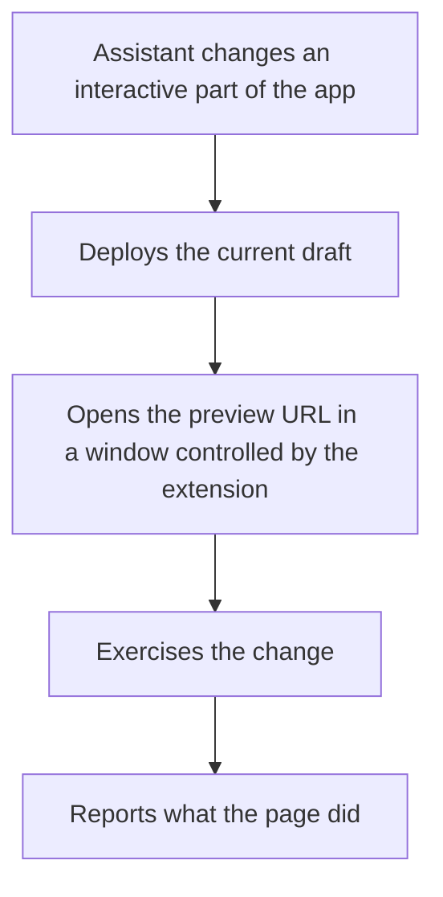

The assistant checks its own changes by opening the application in your browser and exercising the affected behavior. It reports what the page did, not what the change was meant to do.

## When the assistant verifies

The assistant verifies without being asked in two situations:

- **After changing something a user interacts with.** A button action, a field binding, a query, or an API call. The assistant opens the app, triggers the change, and reports the result.
- **When a problem is reported and nobody knows the cause.** For a request such as "the dropdown is empty" or "why is this failing?", the assistant reproduces the problem in the browser first, and only then reads the code. It ends with a clear verdict: a bug in your app, something for the platform team, couldn't reproduce it, or couldn't get far enough to tell.

The assistant verifies once, reports what it found, and asks before fixing anything. Finding a problem does not authorize a fix.

## How verification works

The assistant opens the application in a separate browser window and works inside that window. Verification runs over the connection Studio already holds.

The window stays open for the rest of the conversation and closes shortly after the work finishes. Later verifications in the same chat reuse it.

## What the report contains

The assistant reports what it observed, not what it intended. A statement such as "the service fires on the third character" is a result. "The fix is applied" is not.

The report is a finding, not a fix. The assistant asks before editing anything in response to what it found.

## Sign in and other prompts

Some pages need a person before they can be exercised: a login form, a one-time password, or a consent screen. When the assistant reaches one, it places a prompt bar in that window and waits for you to complete the step and select **Continue**.

The assistant waits up to five minutes. It does not report the task as blocked and does not ask for credentials in the chat. If the wait expires, the verification ends and the report says why.

## Skip browser verification

The prompt box has a **Skip browser verification** toggle. Turn it on to run a chat without a browser. The setting is fixed once the chat starts, like the agent selector, and applies to every turn in that chat.

With the toggle on, the assistant makes the change without opening the app and states in its reply that the change was not verified.

The toggle defaults to on for mobile projects, which do not run in a browser.

## Requirements and limitations

- **Companion Chrome extension.** Browser verification needs the [WaveMaker AI Companion](https://chromewebstore.google.com/detail/dblmconkjbhphedkodkehacfiddcenjc) installed in Chrome. If it is missing, the assistant says so and gives the install link instead of continuing without verification.
- **Chrome only.** The assistant uses the browser the extension controls. Other browsers are not used.
- **Mobile projects.** Native mobile applications do not run in a browser, so verification is skipped by default.
