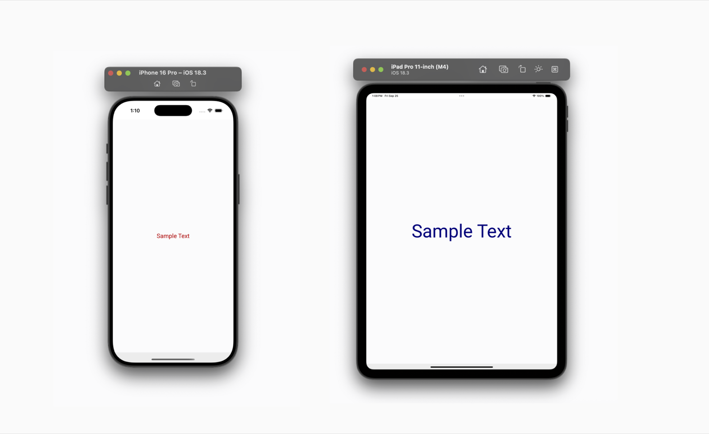
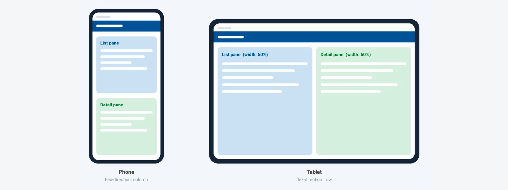
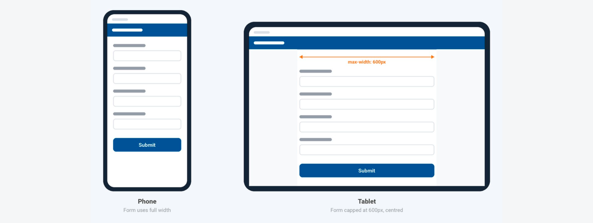

Adaptive layout adjusts the layout and styling of a WaveMaker React Native app to the screen it runs on — from a compact phone to a large tablet. Media queries define styles for different screen widths, so a single screen definition rearranges itself, resizes text, or restyles components on a phone and a tablet without device-specific branching logic in the app.

<video controls width="100%" muted playsInline>
  <source src={require('./assets/vids/adaptive-layout-demo-renamed.mp4').default} type="video/mp4" />
</video>

This page covers:

- How media queries and screen widths decide which styles apply.
- How to write a media query, step by step.
- Common adaptive layout patterns.
- How to change list direction and items per row, which a media query cannot change on its own.
- How to test adaptive screens and fix common issues.

**Prerequisites**

- A WaveMaker React Native (mobile) project open in Studio.
- A basic understanding of CSS selectors and properties.
- A phone and a tablet for testing — real devices or simulators.

## Why adaptive layout

A fixed design stretched to fit every screen wastes space on tablets and crowds content on phones. Adaptive layout gives control over how each screen looks on each class of device — for example, an iPhone and an iPad — while keeping a single page definition.

## What are media queries

Media queries are conditional style rules that apply only when the device's screen matches a condition, such as a minimum or maximum width. The model is the same as in web CSS: define base styles first, then add the exceptions for other screen sizes.

The following example turns a button green on screens 768px and wider:

```css
.button {
  background-color: blue;
}

@media (min-width: 768px) {
  .button {
    background-color: green;
  }
}
```

On smaller screens, the button stays blue.

## Query conditions

A query accepts two conditions:

| Condition   | Applies the styles when the screen width is |
| ----------- | ------------------------------------------- |
| `min-width` | Equal to or greater than the given value.   |
| `max-width` | Equal to or less than the given value.      |

```css
/* Screens 480px and wider */
@media (min-width: 480px) {
  /* ... */
}

/* Screens 479px and narrower */
@media (max-width: 479px) {
  /* ... */
}
```

The platform evaluates the screen width at runtime and applies the matching styles. No device-detection code is required.

## Screen size reference

Use these approximate ranges as a starting point when choosing breakpoints for media queries:

| Device                            | Screen width range |
| --------------------------------- | ------------------ |
| Phones                            | 0 – 479px          |
| Phones (landscape), small tablets | 480px – 767px      |
| Tablets                           | 768px – 1023px     |
| Tablets (landscape)               | 1024px and above   |

Adjust the values to suit the devices the app targets. Use the same values consistently across the app so every screen switches layout at the same widths.

## Merge behavior

More than one query can match at the same time. A tablet 1024px wide matches both `(min-width: 480px)` and `(min-width: 768px)`. When several queries match:

- Media query styles override base styles.
- All matching styles are merged. Only the properties inside the query block change — every other property carries over from the base class.
- Where merged styles conflict, the later rule wins. Place the rule for the widest range last.

## Choosing the right approach

Media queries handle most adaptive changes, but a few are controlled by widget properties instead.

| What needs to change                                | How to change it                                                   | Covered in                                                    |
| --------------------------------------------------- | ------------------------------------------------------------------ | ------------------------------------------------------------- |
| Font size, color, spacing, width, height, alignment | Media query                                                        | [Write your first media query](#write-your-first-media-query) |
| A widget shown on one device and hidden on another  | Media query with `display: none`                                   | [Common adaptive patterns](#common-adaptive-patterns)         |
| Panels stacked on phone, side by side on tablet     | Media query on the container's `flex-direction`                    | [Common adaptive patterns](#common-adaptive-patterns)         |
| List direction (vertical or horizontal)             | A variable bound to the list's direction, set from the page script | [Build an adaptive screen](#build-an-adaptive-screen)         |
| Items per row in a list                             | The list's **Responsive** setting                                  | [Build an adaptive screen](#build-an-adaptive-screen)         |

## Write your first media query

This example builds a label that shows small red text on phones and large navy text on larger screens. Media queries go in the **Style** tab of the app editor, alongside the normal class definitions.

### Step 1: Add a class name to the widget

1. Drag a **Label** onto the page and select it.
2. In the Properties panel, open the **Styles** tab.
3. Under **Additional**, enter a class name in **Class Name** — for example, `sample-text`.

### Step 2: Choose the right selector

Each widget renders with its own built-in classes. To style a widget, combine the custom class with the widget's class, with no space between them. A label has two styleable parts:

| Selector                      | What it styles                                               |
| ----------------------------- | ------------------------------------------------------------ |
| `.sample-text.app-label`      | The label's outer box — size, layout, alignment, background. |
| `.sample-text.app-label-text` | The label's text — font size, color, weight.                 |

Other widgets follow the same pattern. For example, a container uses `.your-class.app-container`.

### Step 3: Write the base styles

Write the base class first. Base styles apply everywhere unless a media query overrides them, so write them for the phone layout:

```css
.sample-text.app-label {
  height: 100%;
  width: 100%;
  display: flex;
  justify-content: center;
  align-items: center;
}

.sample-text.app-label-text {
  text-align: center;
  font-size: 20px;
  color: red;
}
```

### Step 4: Add the media query

Wrap the properties that change in a query. Everything outside the block carries over from the base class. Here, only the text size and color change on screens 480px and wider:

```css
@media (min-width: 480px) {
  .sample-text.app-label-text {
    font-size: 80px;
    color: navy;
  }
}
```

### Step 5: Preview on phone and tablet

Switch the Studio preview between phone and tablet sizes, then run the app on both.



## Common adaptive patterns

Each pattern follows the same approach: write base styles for the phone, then add a query for whatever changes on larger screens. The examples use `768px`, the start of the tablet range in the [Screen size reference](#screen-size-reference).

### Scale text and spacing for tablets

Tablets are held at about the same distance as phones but offer much more room, so slightly larger text and more generous padding usually read better.


```css
.card-body.app-container {
  padding: 12px;
}

@media (min-width: 768px) {
  .card-body.app-container {
    padding: 24px;
  }
}
```

### Show or hide a widget on one device

To show a widget on larger screens only, hide it in the base styles with `display: none`, then bring it back in a query for the width where it belongs. The same query can also change the widget's width, height, or other styles.


```css
.promo-banner.app-container {
  display: none;
}

@media (min-width: 768px) {
  .promo-banner.app-container {
    display: flex;
  }
}
```

### Stack on phone, side by side on tablet

A common tablet layout places two panels — for example, a list and its details — next to each other, while the phone stacks them. Give one class to the parent container and another to each panel:



```css
/* Phone: panels stacked */
.split-view.app-container {
  flex-direction: column;
}

.split-pane.app-container {
  width: 100%;
}

/* Tablet: panels side by side */
@media (min-width: 768px) {
  .split-view.app-container {
    flex-direction: row;
  }
  .split-pane.app-container {
    width: 50%;
  }
}
```

:::tip
Set a container's direction in one place only. When a media query controls the direction, leave the container's own **Direction** property in [Auto Layout](./auto-layout) at its default so the two do not conflict.
:::

### Keep content readable on wide screens

Forms and long text are hard to read when stretched across the full width of a tablet. Cap the width and center the content on tablets:



```css
@media (min-width: 768px) {
  .form-wrapper.app-container {
    width: 100%;
    max-width: 600px;
    align-self: center;
  }
}
```

## Build an adaptive screen

This section puts the patterns together in a sample screen and covers the cases a media query cannot handle on its own. The design is not a replica of any existing app — it shows what the feature can do across two device sizes.


The phone and tablet layouts differ in three ways:

| Difference                | Phone              | Tablet                | How it is built          |
| ------------------------- | ------------------ | --------------------- | ------------------------ |
| Second list direction     | Stacked vertically | Scrolls horizontally  | Variable and page script |
| Second list items per row | 2                  | 1                     | Responsive setting       |
| Left navigation           | Hidden             | Shown as a side panel | Media query              |

### List direction

A list's direction is a property of the List widget, not a style, so `@media` cannot change it. Direction is set from **Layout** → **Direction** in the Properties panel, or from the `direction` attribute in the page markup.

To change the direction by device, bind it to a variable and set the variable from the page script.

#### Step 1: Create a variable

1. Open **Variables** from the top bar, click **New Variable**, and choose **Model**.
2. Set **Name** to `listDirection` and **Owner** to **Page**.
3. Set **Type** to **String**, enter `column` as the `dataValue`, and click **Save & Close**.

For more on model variables, see [Variables and types](../integrating-with-apis/variables).

#### Step 2: Bind the variable to the list

Point the list's `direction` property at the variable, either with the bind icon in the Properties panel or directly in the markup:

```xml
<wm-list name="secondaryListList1"
    dataset="bind:Variables.secondaryList.dataSet"
    itemsperrow="xs-2 sm-1 md-1 lg-1"
    direction="bind:Variables.listDirection.dataSet.dataValue">
    <wm-listtemplate layout="inline" name="listtemplate2">
        <wm-picture name="picture2"
            picturesource="bind:Variables.secondaryList.dataSet[$i].imageUrl"
            height="220px" width="170px" resizemode="cover"></wm-picture>
    </wm-listtemplate>
</wm-list>
```

#### Step 3: Update the variable from the page script

In the page **Script** tab, switch the direction when the screen is tablet-sized:

```js
const { Dimensions } = require('react-native');

Page.onReady = function () {
  // ...
  if (Dimensions.get('window').width >= 768) {
    Page.Variables.listDirection.setValue('dataValue', 'row');
  }
};
```

Phones keep the default `column` direction. On tablets, the script switches it to `row` as soon as the page loads. For more on `Page.onReady`, see [App and page lifecycle events](../events/app-page-events).

:::note

- Match the width in the script to the breakpoint used by the media queries — `768` in this example. If the breakpoint changes later, update the script too.
- The check runs once, when the page loads. Unlike a media query, it does not run again when the device rotates.
  :::

### Items per row

Items per row is also a widget property, so a media query cannot set it. The List widget has a responsive setting for it instead:

1. Select the list, open the **Device Sizes** tab, and turn on **Responsive**.
2. In the **Items per row** table, set **Mobile** to `2`.


The list then uses the configured count for whichever device mode it runs in. In the markup, the setting appears as the `itemsperrow` attribute — for example, `itemsperrow="xs-2 sm-1 md-1 lg-1"`.

### Left navigation on tablet

Build the side menu inside a container widget, add the menu items as nested containers with icons and labels, and give the outer container the class `left-menu`.

The menu belongs on tablets only, which is what media queries are for. Hide the container in the base styles:

```css
.left-menu.app-container {
  display: none;
}
```

Then show it on tablet-width screens:

```css
@media (min-width: 768px) {
  .left-menu.app-container {
    display: block;
    height: 100%;
    width: 30%;
  }
}
```

Phones keep the menu hidden. Tablets show it as a side panel that takes up 30% of the screen width.

### Test the finished screen

1. Preview the page in Studio at phone and tablet sizes.
2. Run it on a phone and a tablet, in both portrait and landscape.
3. Confirm that each of the three differences in the table above appears on the right devices.

## Best practices

- **Style the phone first.** Define base styles for the phone layout and add `min-width` overrides on top. Smaller screens stay clean, and larger-screen styles never need to be reversed.
- **Keep queries focused.** Include only the properties that change, so the difference between each screen size and the base design is easy to see.
- **Use a fixed set of breakpoints.** Pick the widths once, based on the [Screen size reference](#screen-size-reference), and reuse them in every query and script so layouts stay consistent across screens.
- **Name classes by purpose.** Use names such as `left-menu` or `split-view` and reuse them, so one query updates every matching widget.
- **Review both orientations.** Rotating a device changes its width, so a different query may match. Check every screen in landscape as well as portrait.
- **Test on target devices.** The editor preview does not account for safe areas, system bars, and other details that affect how content fits on a real device.

## Limitations

- Items per row in a list follows the matched device mode's configured value and cannot be set through a media query.
- List direction is a property of the List widget, so a media query cannot switch it between vertical and horizontal.
- Only one value wins per property, so plan overlapping ranges carefully to avoid unexpected merges.

The first two limitations have workarounds, described in [Build an adaptive screen](#build-an-adaptive-screen).

## Troubleshooting

| Problem                                                 | What to check                                                                                                                                                                                  |
| ------------------------------------------------------- | ---------------------------------------------------------------------------------------------------------------------------------------------------------------------------------------------- |
| Styles are not applied at all                           | Confirm the class name is in the widget's **Class Name** field, and that the selector combines the custom class with the widget's class with no space — for example, `.sample-text.app-label`. |
| The query never matches                                 | Check the condition spelling (`min-width` or `max-width`) and that the value includes the `px` unit.                                                                                           |
| A large phone gets the tablet layout                    | Its width is at or above the `min-width` value. Raise the breakpoint in the query.                                                                                                             |
| Two rules set the same property and conflict            | The later rule wins. Move the rule for the widest range to the end.                                                                                                                            |
| A query does not change list direction or items per row | These are widget properties, not styles. Use the variable and page script, or the list's **Responsive** setting.                                                                               |
| The layout does not update after rotation               | Media queries update live, but script logic in `Page.onReady` runs only once, when the page loads.                                                                                             |
