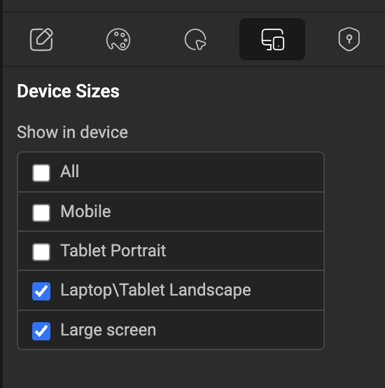
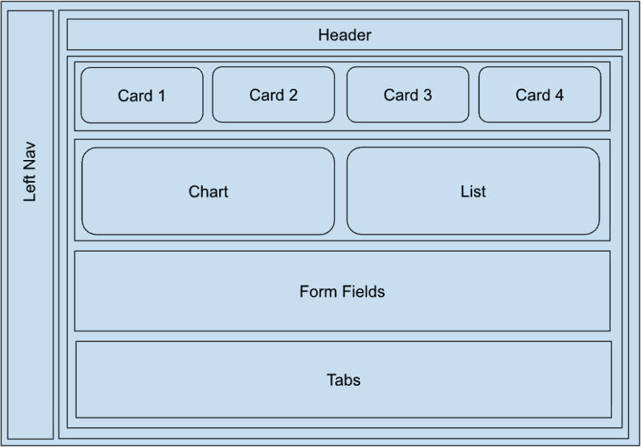
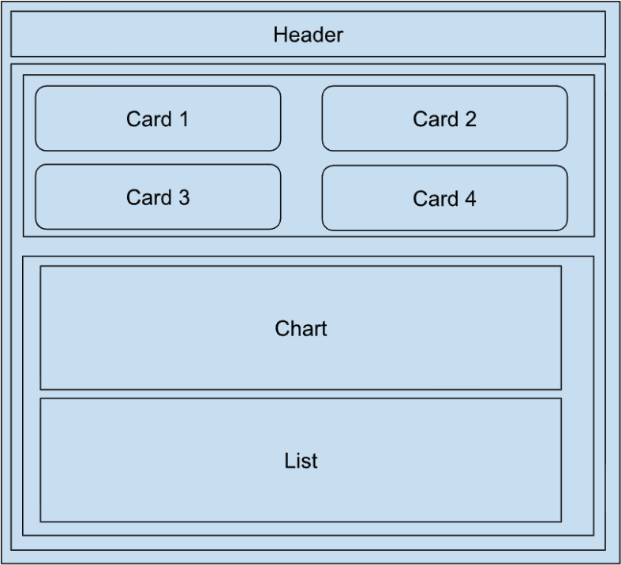
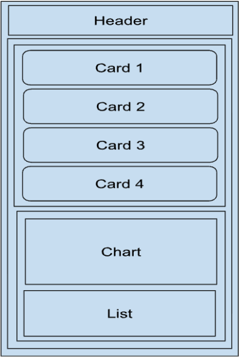

In WaveMaker, responsive design with layouts means building apps that automatically adapt their UI to different screen sizes like mobile, tablet, and desktop without creating separate apps.

Responsive design ensures that:

- The UI adjusts smoothly based on screen size.
- Content rearranges, resizes, or hides and shows depending on the device.
- Users get a consistent experience on phone, tablet, or web.

WaveMaker combines [**Auto Layout**](./auto-layout), **responsive properties**, **Page Layout**, and **viewport breakpoints** to implement this behavior:

| Approach   | Use it to                                                                 | Tools                                                        |
| ---------- | ------------------------------------------------------------------------- | ------------------------------------------------------------ |
| Responsive | Adjust sizing, spacing, alignment, and wrapping based on available space. | Auto Layout, responsive properties                           |
| Adaptive   | Change the layout, visibility, or behavior at specific viewport sizes.    | Page Layout, Device visibility, viewport-specific properties |
| Custom CSS | Cover behavior the platform properties can't achieve.                     | App and page CSS                                             |

Use custom CSS only when the required behavior can't be achieved through the available platform properties.

## Device visibility per component

WaveMaker provides a simple way to manage responsiveness using device-based visibility. For every component, the **Device** tab in the Properties panel lets you:

- Show the component only on specific screen sizes.
- Hide the component on certain devices.
- Build separate UI patterns for mobile and desktop without duplicating pages.



This is useful when:

- A sidebar should appear only on large screens.
- A compact menu should appear only on mobile.
- A large table should be hidden on smaller devices and replaced with a card or list view.

## Auto Layout for responsive alignment

WaveMaker also supports [Auto Layout](./auto-layout), which acts like a built-in responsive layout system. Instead of relying heavily on manual margins, paddings, and custom CSS, you control responsiveness using container properties:

- **Direction**: row or column.
- **Wrap**: allow items to move to the next line.
- **Fill / Hug**: dynamic sizing based on available space.
- **Alignment**: start, center, end.
- **Gap**: consistent spacing between components.
- **Padding**: container spacing.

These settings let components automatically resize and realign as the screen changes, giving you a clean responsive UI with minimal effort.

## Page layout

Design System projects support responsive page layouts across device and viewport sizes, with consistent behavior in Angular and React previews. Use the predefined layouts provided for the page layout.

| Region       | Using existing properties                                                                                                  | Needs custom code                                                                                          |
| ------------ | -------------------------------------------------------------------------------------------------------------------------- | ---------------------------------------------------------------------------------------------------------- |
| Left nav     | Width (Drawer, Rail), height (Fill, Clipped), and animation (Slide-in, Slide-over). Style it from the **Style Workspace**. | Expanding and collapsing the left nav on large screens.                                                    |
| Top nav      | Fully achievable.                                                                                                          | None.                                                                                                      |
| Header       | Use the existing header functionality and styling.                                                                         | A hamburger button, hidden on large screens and shown on smaller ones, to expand or collapse the left nav. |
| Footer       | Fully achievable.                                                                                                          | None.                                                                                                      |
| Page content | Fully achievable with Auto Layout.                                                                                         | None.                                                                                                      |
| Right nav    | Fill and Clipped height combinations.                                                                                      | Expanding or collapsing the right nav based on device size.                                                |

### Viewport breakpoints

Responsive page layout behavior is based on the following viewport breakpoints:

- 480px
- 576px
- 768px
- 992px
- Large screens, above 992px

### Design System and non-Design System support

| Region                     | Design System        | Non-Design System    | Notes                                                   |
| -------------------------- | -------------------- | -------------------- | ------------------------------------------------------- |
| Left nav: Drawer, Clipped  | Supported            | Supported            | Supported by default in both.                           |
| Left nav: Drawer, Fill     | Supported            | Workaround available |                                                         |
| Left nav: Rail, Clipped    | Supported            | Workaround available |                                                         |
| Left nav: Rail, Fill       | Supported            | Workaround available |                                                         |
| Right nav: Drawer, Clipped | Workaround available | Workaround available | Planned for a future release in Design System projects. |
| Right nav: Drawer, Fill    | Supported            | Workaround available |                                                         |
| Right nav: Rail, Clipped   | Workaround available | Workaround available | Planned for a future release in Design System projects. |
| Right nav: Rail, Fill      | Supported            | Workaround available |                                                         |
| Header                     | Supported            | Supported            |                                                         |
| Top nav                    | Supported            | Supported            |                                                         |
| Footer                     | Supported            | Supported            |                                                         |

## Widget responsiveness

Most widgets become responsive through the Auto Layout settings of their parent container, combined with a minimum or maximum width on the items. The examples below use small utility classes for widths, such as:

```css
.wm-app .min-w-384 {
  min-width: 24rem !important;
}
```

Add these classes in the app or page CSS, then apply them to components through the **Class** property.

### Cards

| Do                                                                                               | Don't                                                                        |
| ------------------------------------------------------------------------------------------------ | ---------------------------------------------------------------------------- |
| Use the card or container's **Auto Layout** properties to control content alignment and spacing. | Use absolute positioning to place content inside the card.                   |
| Use **Wrap** to let cards move to the next row on smaller viewports.                             | Create separate card layouts for desktop, tablet, and mobile.                |
| Use a suitable **minimum width** when cards need to keep their content structure.                | Use a fixed width that prevents cards from wrapping.                         |
| Use **Gap** to keep spacing between cards consistent.                                            | Add individual margins to every card when **Gap** achieves the same spacing. |
| Use responsive width properties when the number of cards per row needs to change.                | Change the width of each card at every breakpoint.                           |

Arrange cards in one of two patterns, based on the available space and design:

- **Wrap**: cards move to the next row when the horizontal space runs out.
- **Scroll**: cards stay in a single row and scroll horizontally.

Minimum and maximum widths are set through CSS classes.

#### Cards with wrap

Cards are placed horizontally and move to the next row when the row runs out of space. The configured gap is kept between cards, and the number of cards per row changes with the viewport width, for example 3 per row on desktop, 2 on tablet, and 1 on mobile.

<video controls width="100%" muted playsInline>
  <source src={require('./assets/vids/cards-wrap.mp4').default} type="video/mp4" />
</video>

To create a wrapping card layout:

1. Apply a minimum width to the cards:

   ```css
   .wm-app .min-w-384 {
     min-width: 24rem !important;
   }
   ```

2. Set the parent container's **Layout** to **Row** and **Wrap** to **True**.

#### Cards with scroll

Cards stay in a single row and scroll horizontally when there isn't enough space to show them all. Use this when cards need a consistent width without wrapping to multiple rows.

<video controls width="100%" muted playsInline>
  <source src={require('./assets/vids/cards-scroll.mp4').default} type="video/mp4" />
</video>

To create a scrolling card layout:

1. Apply a minimum width to each card using the same `.min-w-384` class.
2. Set the parent container's **Layout** to **Row**, **Wrap** to **False**, and **Overflow** to **Auto** or **Scroll**.

### Form fields

| Do                                                                           | Don't                                                         |
| ---------------------------------------------------------------------------- | ------------------------------------------------------------- |
| Use containers with Auto Layout to organize form fields.                     | Position each form field manually.                            |
| Use **Direction**, **Wrap**, **Gap**, and alignment to control field layout. | Override margins on every field to create spacing.            |
| Let form fields stack when the available width gets smaller.                 | Force a multi-column form layout on mobile.                   |
| Use consistent field widths or minimum widths where required.                | Assign arbitrary fixed widths that cause horizontal overflow. |
| Keep form field styling reusable through classes.                            | Write separate CSS for every form field instance.             |

Form fields are typically arranged in a row with **Wrap** turned on, so they reflow across viewport sizes, for example 3 fields per row on desktop, 2 on tablet, and 1 on mobile.

<video controls width="100%" muted playsInline>
  <source src={require('./assets/vids/form-fields-wrap.mp4').default} type="video/mp4" />
</video>

To create a wrapping form layout:

1. Set a width and minimum width on each form field:

   ```css
   .min-w-384 {
     min-width: 24rem !important;
   }

   .w-384 {
     width: 24rem !important;
   }
   ```

   Alternatively, set the field width in the **Style Workspace** using the `control-width` property, for example `control-width: 384px`.

2. Set the parent container's **Layout** to **Row** and **Wrap** to **True**.

### Lists

| Do                                                                                | Don't                                                                                    |
| --------------------------------------------------------------------------------- | ---------------------------------------------------------------------------------------- |
| Configure the list item layout using Auto Layout properties.                      | Depend on the generated HTML structure of a list item.                                   |
| Use classes to style list items consistently.                                     | Target a specific list item using generated attributes such as `name`.                   |
| Use responsive properties for list item width, direction, alignment, and spacing. | Write separate CSS for Angular and React.                                                |
| Use the supported background and image properties of the List widget.             | Rely on selectors such as `.bg-container[name="container3_1"]` to apply widget behavior. |
| Let list content grow based on its data.                                          | Use fixed heights that can clip dynamically generated list content.                      |

Lists support the same patterns as cards. List items wrap or scroll based on the layout requirement.

<video controls width="100%" muted playsInline>
  <source src={require('./assets/vids/list-wrap.mp4').default} type="video/mp4" />
</video>

To create a responsive list layout:

1. Set the minimum and maximum width for list items:

   ```css
   .wm-app .min-w-384 {
     min-width: 24rem !important;
   }

   .wm-app .max-w-740 {
     max-width: 46.25rem !important;
   }
   ```

   `min-w-384` keeps the list item from getting narrower than the required width, and `max-w-740` keeps it from getting too wide on larger screens.

2. Set the parent container's **Layout** to **Row**. Set **Wrap** to **True** for a wrapping layout, or to **False** with overflow set to scroll for a scrolling layout.

### Tabs

| Do                                                                     | Don't                                                                 |
| ---------------------------------------------------------------------- | --------------------------------------------------------------------- |
| Use the Tabs widget and its supported properties for tab navigation.   | Recreate tab behavior with custom containers and CSS unless required. |
| Let tab content adapt to the available viewport.                       | Assign fixed widths that make the tab navigation overflow.            |
| Use the existing tab variants and design tokens where applicable.      | Override the generated tab structure with deeply nested selectors.    |
| Keep tab styling class-based and runtime-independent.                  | Use Angular-specific DOM selectors for tab styling.                   |
| Check both tab navigation and tab content at different viewport sizes. | Check only the default or desktop tab state.                          |

Make the content inside each tab responsive using Auto Layout, so it adapts to the available space and viewport size.

### Wizard

| Do                                                                                 | Don't                                                                                               |
| ---------------------------------------------------------------------------------- | --------------------------------------------------------------------------------------------------- |
| Use the Wizard widget's built-in steps, navigation, and layout properties.         | Recreate wizard navigation or step behavior with custom containers and CSS.                         |
| Use Auto Layout for the content within each step.                                  | Use absolute positioning for fields or components inside a step.                                    |
| Let the wizard content adapt to the available viewport width.                      | Use fixed widths that make the wizard content overflow on smaller screens.                          |
| Keep step content responsive independently of the wizard navigation.               | Assume every step's content has the same height or width.                                           |
| Use **Gap**, **Padding**, alignment, and **Wrap** to manage spacing within a step. | Use hardcoded margins to position individual elements.                                              |
| Let form fields and components within a step wrap or stack on smaller viewports.   | Keep desktop multi-column layouts unchanged on mobile.                                              |
| Use reusable classes for custom wizard styling.                                    | Target wizard elements using generated attributes such as `name` or runtime-specific DOM selectors. |
| Check the wizard in its default, active, and current step states.                  | Check only the first step or the default state.                                                     |
| Check wizard behavior in both Angular and React previews.                          | Assume Angular-generated wizard markup matches React.                                               |
| Use the existing wizard variants and design tokens where applicable.               | Override the wizard's generated styles with highly specific selectors or unnecessary `!important`.  |
| Use horizontal wizard steppers on mobile.                                          | Use vertical wizard steppers on mobile.                                                             |

Make the content inside each wizard step responsive using Auto Layout. On smaller viewports, a vertical wizard changes to a horizontal wizard for a more suitable layout.

### Panel

| Do                                                                                       | Don't                                                                  |
| ---------------------------------------------------------------------------------------- | ---------------------------------------------------------------------- |
| Use the panel as a layout container and define its behavior with Auto Layout properties. | Use the panel as a container for manually positioned elements.         |
| Use responsive width, height, padding, and gap properties where required.                | Hardcode dimensions that keep the panel from adapting to the viewport. |
| Reuse common container styles.                                                           | Write page-specific selectors for every panel instance.                |

Make the content inside the panel responsive using Auto Layout, so it adapts to the available space and viewport size.

### Table

| Do                                                                                 | Don't                                                                                           |
| ---------------------------------------------------------------------------------- | ----------------------------------------------------------------------------------------------- |
| Use the Data Table's supported responsive and scrolling behavior.                  | Force all columns to fit within the viewport using fixed widths.                                |
| Define minimum widths for columns where the content needs them.                    | Shrink columns until the content becomes unusable.                                              |
| Allow horizontal scrolling when the table can't reasonably fit on smaller screens. | Hide important columns just to make the table fit, unless that behavior is explicitly required. |
| Keep column configuration independent of the generated DOM structure.              | Target generated table cells using positional or attribute selectors.                           |
| Check the table at desktop, tablet, and mobile viewport sizes.                     | Optimize the table only for the desktop layout.                                                 |

Tables support horizontal scrolling for columns that exceed the viewport width. The table structure and column layout stay intact while the full content remains reachable on smaller screens.

### Accordion

| Do                                                         | Don't                                                                |
| ---------------------------------------------------------- | -------------------------------------------------------------------- |
| Let accordion content determine its natural height.        | Use fixed heights for expandable accordion content.                  |
| Use Auto Layout for the content inside accordion sections. | Position elements manually inside each accordion section.            |
| Keep spacing consistent using **Gap** and **Padding**.     | Override margins on individual elements to achieve the same spacing. |
| Check both the expanded and collapsed states.              | Check only the collapsed state.                                      |
| Keep content accessible as the viewport gets smaller.      | Use overflow settings or fixed heights that clip expanded content.   |

Make the content inside each accordion section responsive using Auto Layout, so it adapts to the available space and viewport size.

### Login

| Do                                                                               | Don't                                                                                   |
| -------------------------------------------------------------------------------- | --------------------------------------------------------------------------------------- |
| Use device visibility to control sections that aren't needed on smaller devices. | Create a separate login page for mobile unless there's a functional requirement.        |
| Hide or change the informational section on mobile when it isn't needed.         | Leave non-essential content visible when it takes space from the login form.            |
| Use Auto Layout properties to center and align the login form.                   | Use absolute positioning to center the login form.                                      |
| Let the login form adapt to the available viewport width.                        | Use a fixed width that causes horizontal scrolling on mobile.                           |
| Keep the login form accessible across desktop, tablet, and mobile viewports.     | Write separate CSS for each device when WaveMaker properties achieve the same behavior. |
| Check the layout at every supported viewport size.                               | Check only the desktop layout and assume mobile adapts automatically.                   |

<video controls width="100%" muted playsInline>
  <source src={require('./assets/vids/login-responsive.mp4').default} type="video/mp4" />
</video>

The login page in this example has two sections: an informational section on the left and the login form on the right. On smaller viewports such as mobile, the informational section is hidden and the login form is centered on the page.

To hide the informational section on mobile, select it, open the **Device** tab in the Properties panel, and clear the device sizes it shouldn't appear on, such as **Mobile** and **Tablet Portrait**. See [Device visibility per component](#device-visibility-per-component).

## Complete responsive page example

The following example shows how a page with commonly used widgets adapts across desktop, tablet, and mobile viewports. On large screens, the page has a left nav, a header, a row of four cards, a chart and a list side by side, form fields, and tabs.



On tablet, the left nav is hidden, the cards wrap to two per row, and the chart and list stack.



On mobile, the cards show one per row, followed by the chart and the list.



### Cards

The four cards reflow based on the viewport width: four per row on desktop, two on tablet, and one on mobile, centered in the available space.

To achieve this:

1. Apply a minimum width to each card:

   ```css
   .min-w-288 {
     min-width: 18rem !important;
   }
   ```

2. Set the parent container's **Direction** to **Row** and **Wrap** to **True**.

3. For mobile viewports, set `justify-content: center` on the parent container through a media query to center the cards.

The same card layout adapts across all three viewports without separate layouts for each device.

### Charts and list

The chart and list share the parent container's width equally, with a minimum width of 384px each. When there isn't enough space to show them side by side, they wrap to the next row.

To achieve this:

1. Apply a minimum width to the chart and the list:

   ```css
   .min-w-384 {
     min-width: 384px !important;
   }
   ```

2. Set the parent container's **Direction** to **Row** and **Wrap** to **True**.

### Try it

- [Preview link](https://apps-platform.wavemaker.ai/psteam/Responsive_Flow/#/Page1)
- [Source code](https://drive.google.com/file/d/1Hv9NaTWkMFUM71NJ2t-1VrF9kbeqF3Hv/view?usp=drive_link)
- [Page layout project](https://drive.google.com/file/d/1p7JcayKlVp9GF-TjuZezV1OeeZ9N9C15/view?usp=drive_link)

## Implementation guidelines

### Avoid attribute selectors

Don't use generated HTML attributes or DOM-specific structures for styling or functionality. Avoid selectors like these:

```css
/* Generated name attributes */
.wm-app .app-list-item .bg-container[name="container3_1"] {
  background-size: cover;
}

/* Generated widget names */
input[name="textinput1"] {
  width: 100%;
}

/* Generated widget IDs */
#button1 {
  margin-left: 10px;
}

/* Generated attributes combined with DOM structure */
.wm-app .app-list-item div[name="container3_1"] .wm-picture {
  width: 100%;
}

/* Widget-specific generated attributes */
.wm-widget[name="select1"] .form-control {
  border-radius: 8px;
}
```

Instead, use a meaningful class that describes the intended styling, and apply it to the component through the **Class** property:

```css
.card-background {
  background-size: cover;
}

.form-field {
  width: 100%;
}

.primary-action {
  margin-left: 10px;
}
```

Generated attributes, IDs, and DOM structures are implementation details that can differ between Angular and React, so styling based on them behaves inconsistently across previews and deployed apps. Prefer component classes, reusable classes, design tokens, and supported widget properties.

### Avoid Angular- or React-specific CSS

Angular and React can generate different DOM structures for the same WaveMaker component, so don't write CSS based on one runtime's DOM. For example, avoid writing one selector for Angular and another for React:

```css
/* Angular-specific */
.wm-app .app-list-item .bg-container {
  background-size: cover;
}

/* React-specific */
.wm-list-item .background-container {
  background-size: cover;
}
```

The same applies to responsive behavior:

```css
/* Angular-specific */
.wm-app .app-page-content .app-list {
  display: flex;
}

/* React-specific */
.app-page-content .wm-list {
  display: flex;
}
```

Instead, define the behavior independently of the generated DOM:

```css
.responsive-list {
  width: 100%;
}
```

Then use Auto Layout, responsive properties, reusable classes, and supported widget properties to implement it consistently in both runtimes. The CSS should describe what the component needs to do, not how Angular or React happens to generate its DOM. This avoids duplicate CSS, runtime-specific fixes, inconsistent previews, and CSS that breaks when the generated DOM changes.

### Keep breakpoints limited

Use breakpoints only when a layout needs a specific responsive or adaptive behavior. Avoid adding a breakpoint at every viewport size just to adjust the size or position of individual components:

```css
@media (max-width: 992px) { /* ... */ }
@media (max-width: 768px) { /* ... */ }
@media (max-width: 576px) { /* ... */ }
@media (max-width: 480px) { /* ... */ }
```

The same behavior can usually be achieved with Auto Layout, using **Wrap**, flexible width, minimum and maximum width, **Gap**, and alignment. For example, cards that need to go from 4 per row on desktop to 2 on tablet and 1 on mobile should use **Wrap**, not a breakpoint for each viewport.

Use Auto Layout for fluid responsive behavior, and breakpoints only for intentional layout or behavior changes.

## Design System and non-Design System comparison

### Page content

| Area           | Design System                                                                                      | Non-Design System                      |
| -------------- | -------------------------------------------------------------------------------------------------- | -------------------------------------- |
| Main content   | Auto Layout                                                                                        | Mostly grid layout                     |
| Responsiveness | Auto Layout with minimum and maximum height and width for most cases, and media queries for a few. | Bootstrap and media queries.           |
| Styling        | Foundation CSS, app CSS, and page CSS.                                                             | Themes, app CSS, and page CSS.         |
| Cards          | Auto Layout properties.                                                                            | Bootstrap classes and grid properties. |
| Lists          | Auto Layout properties.                                                                            | Bootstrap classes and grid properties. |

### Widgets

| Category   | Widget                                                                                                               | Design System | Non-Design System | Difference                                                                                                |
| ---------- | -------------------------------------------------------------------------------------------------------------------- | ------------- | ----------------- | --------------------------------------------------------------------------------------------------------- |
| Structure  | Linear Layout, Linear Flex Layout, Layout Grid                                                                       | Supported     | Supported         | Design System prefers Auto Layout.                                                                        |
| Containers | Container                                                                                                            | Supported     | Supported         | Design System: Auto Layout. Non-Design System: fixed size and padding.                                    |
| Containers | Card                                                                                                                 | Supported     | Supported         | Design System: Auto Layout. Non-Design System: Bootstrap grid.                                            |
| Containers | Tabs, Accordion                                                                                                      | Supported     | Supported         | Design System: Auto Layout inside panes.                                                                  |
| Containers | Form                                                                                                                 | Supported     | Supported         | Design System: Auto Layout and items per row.                                                             |
| Containers | Wizard                                                                                                               | Supported     | Supported         | Design System: new step styles and templates.                                                             |
| Containers | Panel, Tile                                                                                                          | Supported     | Supported         | Same.                                                                                                     |
| Navigation | Nav, Navbar                                                                                                          | Supported     | Supported         | Same.                                                                                                     |
| Navigation | Breadcrumb                                                                                                           | Supported     | Supported         | Design System: prebuilt templates.                                                                        |
| Basic      | Label, Anchor, Tree, Video, Audio, HTML, Iframe, Spinner, Rich Text Editor, Locale                                   | Supported     | Supported         | Same.                                                                                                     |
| Basic      | Button                                                                                                               | Supported     | Supported         | Design System: filled and text styles.                                                                    |
| Basic      | Icon                                                                                                                 | Supported     | Supported         | Design System: Material Icons, no Icon Size.                                                              |
| Basic      | Picture                                                                                                              | Supported     | Supported         | Design System: adds Material Icons. Icon Size is hidden; use Variant instead.                             |
| Basic      | Message                                                                                                              | Supported     | Supported         | Design System: the Shape property (rounded, circle, thumbnail) is hidden; use Variant instead.            |
| Basic      | Progress Bar, Progress Circle                                                                                        | Supported     | Supported         | Design System: the Type property (error, info, loading, success, warning) is hidden; use Variant instead. |
| Basic      | Popover                                                                                                              | Supported     | Supported         | Design System: variant styling.                                                                           |
| Basic      | Search                                                                                                               | Supported     | Supported         | Design System on mobile: extra icons and no-results text.                                                 |
| Form       | Text, Number, Textarea, Select, Chips, Radio Set, Checkbox, Checkbox Set, Switch, Toggle, Button Group               | Supported     | Supported         | Same.                                                                                                     |
| Form       | Date, Datetime, Time, Calendar, Currency, File Upload, Color Picker                                                  | Supported     | Supported         | Same.                                                                                                     |
| Form       | Menu                                                                                                                 | Supported     | Supported         | Design System: no Menu Layout option.                                                                     |
| Form       | Slider                                                                                                               | Supported     | Supported         | Design System: new template with icons and range.                                                         |
| Form       | Icon Button Toggle                                                                                                   | Supported     | Not available     | Design System only.                                                                                       |
| Material 3 | Text Field, Checkbox Set, Radio Set, Switch, Input Chip, Icon Button, Slider, Discrete Slider, Progress Bar, Divider | Supported     | Not available     | Design System only.                                                                                       |
| Data       | Table                                                                                                                | Supported     | Supported         | Design System: its own CRUD form and filter markup.                                                       |
| Data       | List                                                                                                                 | Supported     | Supported         | Design System: Auto Layout and items per row. Non-Design System: Bootstrap classes and grid properties.   |
| Data       | Live Form, Live Filter                                                                                               | Supported     | Supported         | Design System: its own generated markup.                                                                  |
| Charts     | Line, Column, Area, Pie, Bar, Cumulative Line, Donut, Bubble                                                         | Supported     | Supported         | Same.                                                                                                     |
| Advanced   | Login, Carousel, Rating, Marquee                                                                                     | Supported     | Supported         | Same.                                                                                                     |
| Dialogs    | Design, Alert, Confirm, iFrame, Page, Login                                                                          | Supported     | Supported         | Design System: no Modal option; filled and text buttons.                                                  |
| Device     | Camera, Barcode Scanner, Bottom Sheet                                                                                | Supported     | Supported         | Same.                                                                                                     |
| Styling    | Theme and design tokens                                                                                              | Design tokens | Themes            | Design System: Style Workspace. Non-Design System: Themes tab.                                            |
